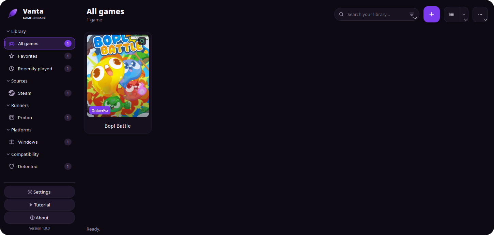

# Vanta

[](https://github.com/ArthurSimin/Vanta/actions/workflows/ci.yml)
[](https://github.com/ArthurSimin/Vanta/releases/latest)
[](LICENSE)

Vanta is a Linux game launcher written in C++17 with Qt 6 Widgets. It keeps a
local library of the games you already own, launches native Linux builds and
Windows builds through Wine or Proton, discovers the runners other launchers
have already installed, and reports what it finds inside a game folder — without
ever downloading a game or claiming that a detected fix works.



The screenshot shows a Vanta installation with only one game: Vanta ships with an empty library and never
adds entries on its own.

## Features

- **One library for everything.** Add a game by pointing Vanta at its executable;
  the game folder is taken from the executable's parent directory. Native, Wine,
  Proton, Flatpak and custom-wrapper launches are all supported from the same
  window. A Windows binary is detected by its PE header, not just its extension,
  and Proton is selected for it automatically.
- **Background scanning.** Every game is inspected on a worker thread through
  `QtConcurrent`. Results are cached in `scan-cache.json`, keyed by game id and
  validated against the game path, the folder modification time and the selected
  executable, so a second start is instant and only changed games are rescanned.
- **Runner discovery.** Vanta finds Wine and Proton builds installed by Steam
  (including extra Steam libraries), Lutris, Heroic and Bottles, including their
  Flatpak variants, plus anything you installed from Vanta itself or configured
  manually.
- **Runner installation.** A built-in dialog can install Wine with your
  distribution's package manager, or download a portable Wine build or the latest
  GE-Proton release from its official GitHub release page.
- **OnlineFix support.** Vanta ports the launcher-side behaviour of OnlineFix
  Linux: signature detection, INI updates with backups, the FreeTP app-id swap,
  `ExtraProtection=false`, the Photon Newtonsoft link and launch-only Wine DLL
  overrides. If Steam is closed when an OnlineFix launch starts, Vanta asks what
  to do instead of starting the client behind your back. See
  [ONLINEFIX.md](ONLINEFIX.md).
- **Cover art from SteamGridDB.** Missing covers are fetched automatically when a
  game is added, or chosen by hand from the editor and the context menu. Names are
  matched fuzzily, so a typo like "Testris" still resolves to "Tetris Ultimate".
  When a game has several artworks, the picker shows every option as a thumbnail
  grid with a full-size preview so you choose the one Vanta uses.
- **Real source icons.** Steam, GOG, Epic, EA and Ubisoft entries use the official
  brand marks from bundled SVGs, recoloured to match the active theme.
- **Themes.** System, Light, Dark and Follow system colors. The System theme
  follows `QStyleHints::colorScheme()` and switches live when the desktop changes;
  Follow system colors derives the whole palette from the active desktop theme,
  so a Breeze Dark session is reproduced with its own window, text and accent
  colors.
- **Grid and list views.** Cover grid with small/medium/large covers and badges,
  or a compact sortable table.
- **Guided tour.** An eight-step spotlight tutorial runs on first start and can be
  replayed from the sidebar or Settings.
- **Honest diagnostics.** Launch failures keep the composed command line, the
  prefix path and the OnlineFix patch log so you can see exactly what happened.

## Requirements

- A C++17 compiler (GCC 11+ or Clang 14+)
- CMake 3.21 or newer
- Qt 6.2 or newer with the **Widgets**, **Svg**, **Concurrent** and **Network**
  modules
- Ninja (recommended) or Make

Qt 6.2 is the floor on purpose: Vanta avoids anything newer so a single build
runs on every distribution from Ubuntu 22.04 onward. On Qt 6.2 and 6.3 the
"Follow system colors" theme falls back to the palette's lightness, because
`QStyleHints::colorScheme()` arrived in 6.5.

Wine and/or Proton are only needed to launch Windows games. Vanta starts and
runs fine without them.

## Installing a package

Just head over to [Releases](https://github.com/ArthurSimin/Vanta/releases) and grab the correct package for your distribution. Prebuilt packages are attached to every release, built on Ubuntu 22.04 against Qt 6.2 so one package covers a whole family of distributions rather than a single release.

| Distribution | Package |
| --- | --- |
| Debian 12+, Ubuntu 22.04+ | `vanta_<version>_amd64.deb` |
| Fedora, openSUSE, RHEL | `vanta-<version>-1.x86_64.rpm` |
| Arch, Manjaro, CachyOS | `vanta-<version>-1-x86_64.pkg.tar.zst` |
| Anything else | `vanta-<version>-linux-x86_64.tar.gz` |

```bash
# Debian / Ubuntu
sudo apt install ./vanta_<version>_amd64.deb

# Fedora / openSUSE
sudo dnf install ./vanta-<version>-1.x86_64.rpm

# Arch / Manjaro / CachyOS
sudo pacman -U vanta-<version>-1-x86_64.pkg.tar.zst
```

Packages are unsigned, so verify the checksum first:

```bash
sha256sum -c SHA256SUMS --ignore-missing
```

The tarball holds the same tree rooted at the archive instead of `/usr`:

```bash
tar -xzf vanta-<version>-linux-x86_64.tar.gz
sudo cp -a vanta-<version>-linux-x86_64/usr/. /usr/local/
```

## Building

### Debian and Ubuntu

```bash
sudo apt update
sudo apt install build-essential cmake ninja-build \
    qt6-base-dev qt6-svg-dev libqt6svg6-dev libgl1-mesa-dev
cmake -S . -B build -G Ninja -DCMAKE_BUILD_TYPE=Release
cmake --build build
```

### Fedora

```bash
sudo dnf install gcc-c++ cmake ninja-build \
    qt6-qtbase-devel qt6-qtsvg-devel mesa-libGL-devel
cmake -S . -B build -G Ninja -DCMAKE_BUILD_TYPE=Release
cmake --build build
```

### Arch Linux and derivatives

```bash
sudo pacman -S --needed base-devel cmake ninja qt6-base qt6-svg mesa
cmake -S . -B build -G Ninja -DCMAKE_BUILD_TYPE=Release
cmake --build build
```

### Any distribution

```bash
cmake -S . -B build -DCMAKE_BUILD_TYPE=Release
cmake --build build -j"$(nproc)"
```

The binary is written to `build/vanta`. The build enables `-Wall -Wextra`,
`QT_NO_CAST_FROM_ASCII` and `QT_USE_QSTRINGBUILDER` and compiles without
warnings.

## Installing

```bash
sudo cmake --install build --prefix /usr/local
```

This installs:

| File | Destination |
| --- | --- |
| `vanta` | `<prefix>/bin/vanta` |
| `vanta.svg` | `<prefix>/share/icons/hicolor/scalable/apps/vanta.svg` |
| `vanta.desktop` | `<prefix>/share/applications/vanta.desktop` |
| `README.md`, `ONLINEFIX.md`, `LICENSE` | `<prefix>/share/doc/vanta/` |

To install into your home directory instead:

```bash
cmake --install build --prefix "$HOME/.local"
```

Run it from the application menu or with `vanta`.

## Usage

### Adding a game

Press **Add game** (`Ctrl+N`) or the `+` button in the header. The editor has
four tabs:

- **General** — name, source, executable, arguments, working folder and cover
  image. There is no separate game folder field: the folder is always the
  executable's parent directory.
- **Runner** — runner type, platform, runner path, prefix folder, WineD3D,
  native Wayland, Steam overlay, SteamLinuxRuntime wrapping, BepInEx
  compatibility, DLL overrides and wrapper arguments.
- **OnlineFix** — per-game mode (Auto, Force, Disabled), detection, app IDs, fix
  folder and Photon folder.
- **Environment** — one `KEY=VALUE` pair per line. Blank lines and lines starting
  with `#` are ignored.

Point the executable row at a `.exe` and Vanta selects Proton plus the Windows
platform for you, since the library is for games rather than Windows utilities.
A native Linux binary selects Native instead. Both are only defaults: change the
runner in the Runner tab whenever you need to.

The cover row has a **SteamGridDB…** button that looks the game name up and opens
the artwork picker. The search is fuzzy, so "Testris" resolves to "Tetris
Ultimate"; the picker lists every available grid with its size and author, streams
thumbnails in as they arrive and previews the selected image full size before you
commit. Covers are downloaded automatically for new games unless you turn that off
in Settings → Covers.

Double-click a card to launch. Right-click for play/stop, details, edit,
favourites, rescan, cover art, OnlineFix and folder actions.

Selecting a game fills the detail strip along the bottom with its cover, name, last
played date and total playtime, plus a **Launch** button. The arrow beside it opens
the same menu as a right-click. When a fix signature is present the **OnlineFix**
chip next to the name is on by default, so the launch applies the configuration the
fix expects; click it to launch without the fix for one run. Nothing is applied
silently — every file Vanta touches is backed up first, and detection is still not
proof that a fix works.

### Prefix layout

If you do not set a prefix folder, Vanta uses `Vanta Prefix` next to the game
executable:

- Wine uses `Vanta Prefix/pfx` as `WINEPREFIX`.
- Proton uses `Vanta Prefix` as `STEAM_COMPAT_DATA_PATH`; teardown uses
  `Vanta Prefix/pfx`.

### Environment rules

Vanta starts from the current process environment, applies the environment you
stored for the game, prepends the forced DXVK override chain, appends your stored
overrides, and finally adds the OnlineFix and BepInEx modules. The following keys
are managed by Vanta and rejected in the editor because changing them would break
the launch:

`WINEPREFIX`, `WINEDLLOVERRIDES`, `WINEDEBUG`, `STEAM_COMPAT_DATA_PATH`,
`STEAM_COMPAT_CLIENT_INSTALL_PATH`, `PROTON_USE_WINED3D`, `PROTON_ENABLE_WAYLAND`,
`STEAMAPPID`, `STEAMGAMEID`, `STEAMOVERLAYGAMEID`,
`ENABLE_VK_LAYER_VALVE_STEAM_OVERLAY_1` and `LD_PRELOAD`.

### Runner management

Open **Settings → Runners** or **Main menu → Download runners…**:

- **System Wine** uses the package manager detected from your distribution
  (`apt-get`, `dnf`, `pacman`, `zypper`, `apk`, `eopkg` or `xbps-install`). Vanta
  runs it directly when it is root, otherwise through `pkexec`, then through
  `sudo -n`. If no elevation path works it shows the exact command to run yourself
  and offers the portable Wine build instead. When no known package manager is
  found the panel says so and only the portable options remain.
- **Portable Wine** downloads the latest Kron4ek Wine build (WoW64, typically
  around 100 MB).
- **GE-Proton** downloads the latest GloriousEggroll release (usually around
  550 MB).

Managed runners are unpacked under
`$XDG_DATA_HOME/vanta/runners/{wine,proton}` and appear in the editor
immediately. Downloads run through `QNetworkAccessManager` with progress,
cancellation and a size/`bin/` sanity check after extraction.

## Files

| Purpose | Path |
| --- | --- |
| Library | `$XDG_CONFIG_HOME/vanta/library.json` |
| Settings | `$XDG_CONFIG_HOME/vanta/settings.json` |
| Scan cache | `$XDG_CACHE_HOME/vanta/scan-cache.json` |
| Managed runners | `$XDG_DATA_HOME/vanta/runners/` |
| Downloaded cover art | `$XDG_DATA_HOME/vanta/covers/` |

All JSON is written atomically with `QSaveFile` (temporary file, `fsync`,
rename), so a crash never leaves a half-written library. A corrupt file is
quarantined next to the original and Vanta starts with defaults instead of
overwriting your data.

## Privacy

Vanta makes network requests in exactly two situations, both of which you start:

1. Downloading a runner (GitHub release metadata and the release asset).
2. Downloading cover art from [SteamGridDB](https://www.steamgriddb.com/), which
   sends only the game name you asked it to look up. Turn off "Fetch missing
   cover art automatically" in Settings → Covers to keep lookups entirely manual.

Nothing else leaves the machine. There is no telemetry, no analytics, no update
check and no account.

Everything else is local. The scanner only reads file names, sizes, timestamps
and, for Windows executables, the PE header architecture.

## Limitations

- Vanta cannot verify that an OnlineFix configuration works, and never claims
  that detected files are functional. It does not patch executables and does not
  download fix files.
- Detection is filename- and INI-based. A file that matches a signature may be
  unrelated, and a working fix may be missed.
- Playtime is measured while Vanta is running the game. Launching outside Vanta
  is not tracked.
- Steam integration is limited to discovering Steam libraries, the Steam Linux
  Runtime and starting Steam when you ask it to from the OnlineFix prompt. Vanta
  is not a Steam client and does not read your Steam credentials.
- Cover matching is a heuristic. A title that shares a name with a sequel or a
  spin-off can resolve to the wrong entry; the editor always shows the matched
  name before you save, and you can browse for your own image instead.

## Credits

- OnlineFix Linux (OFLL) by **ZzEdovec** — the launcher-side OnlineFix behaviour
  in Vanta is a port of that project:
  <https://github.com/ZzEdovec/onlinefix-linux>
- Qt 6, CMake and Ninja.
- The Vanta logo and interface glyphs are original to Vanta. The Steam, GOG,
  Epic Games, EA and Ubisoft marks under `resources/icons/brand/` come from
  [Simple Icons](https://simpleicons.org) (CC0 1.0) and remain trademarks of
  their respective owners; they are used only to identify the store a game came
  from.

## Development

Build and contribution conventions are documented in [AGENTS.md](AGENTS.md).
GitHub Actions builds every push with both GCC and Clang and fails on any
compiler warning.

## License

Vanta is licensed under the **GNU Affero General Public License v3.0**. See
[LICENSE](LICENSE). Because the OnlineFix behaviour is derived from OFLL, which is
AGPL-3.0, the same license applies to this project.
